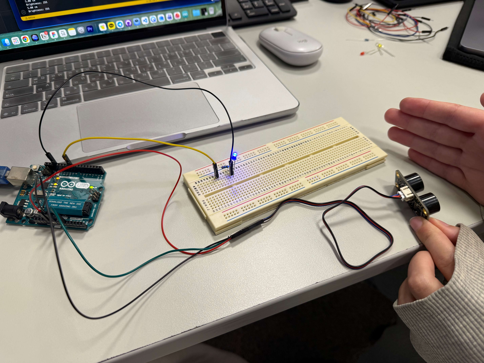
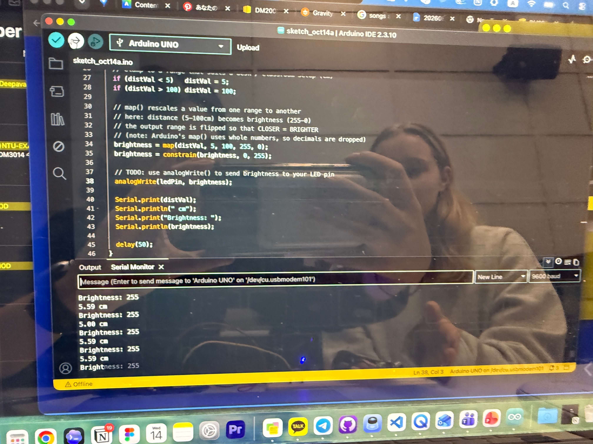
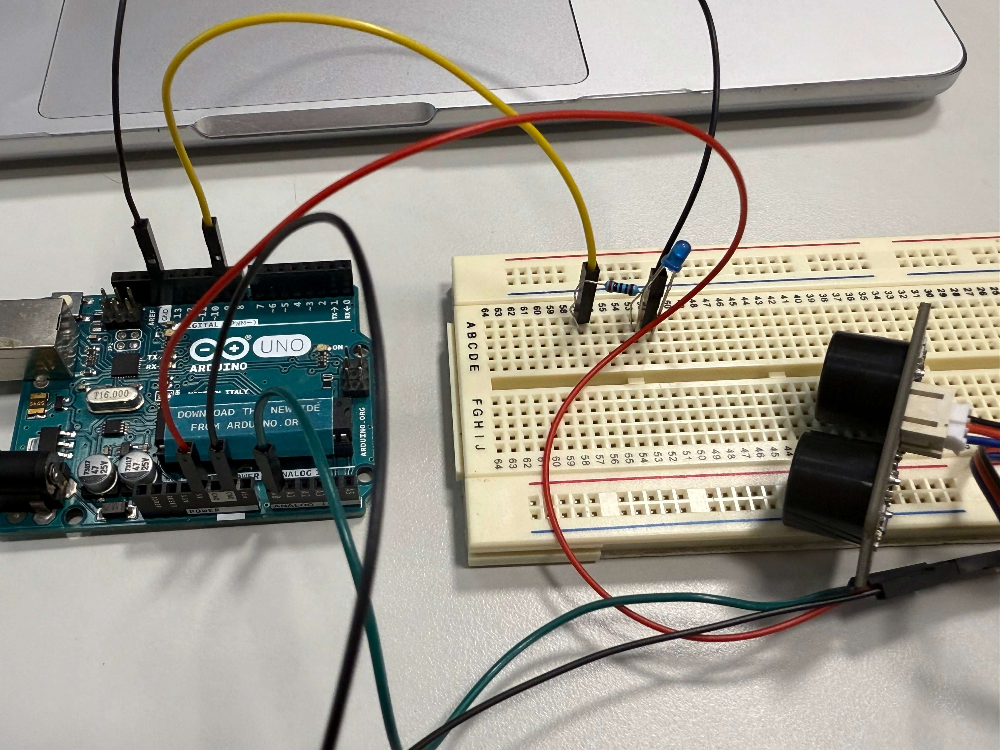

# Week 09 — Sensor to Screen

---

### Activities

| Activity | What I Made                   |
| -------- | ----------------------------- |
| `9a`     | 	Used map() to control LED brightness with ultrasonic distance readings and explored sending sensor data from Arduino to p5.js over serial communication. |

---

### This Week

I learned how to connect physical inputs to digital outputs using Arduino and p5.js. I used map() to translate ultrasonic sensor readings into LED brightness and explored serial communication for screen-based interactions. I also tested my setup and refined the code and wiring to make the output more responsive and smooth.

---

### Documentation

---