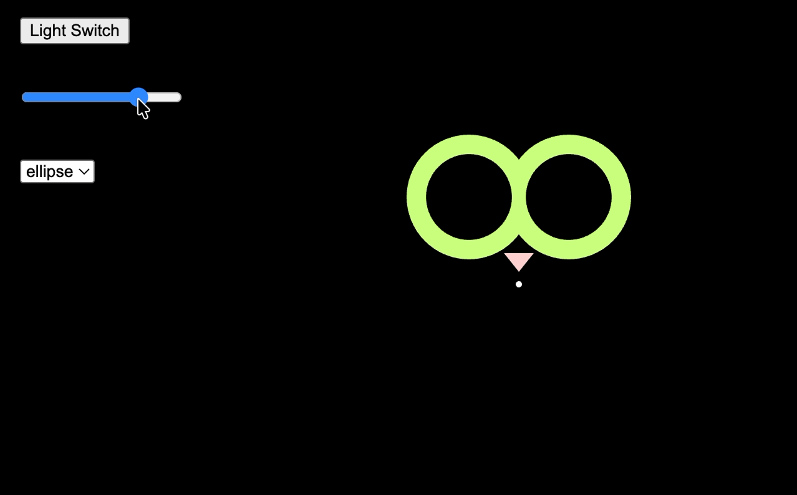
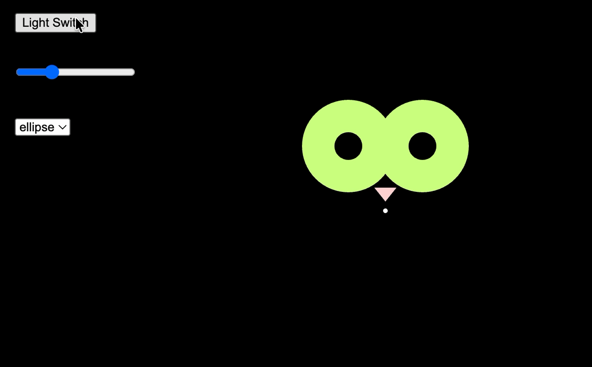
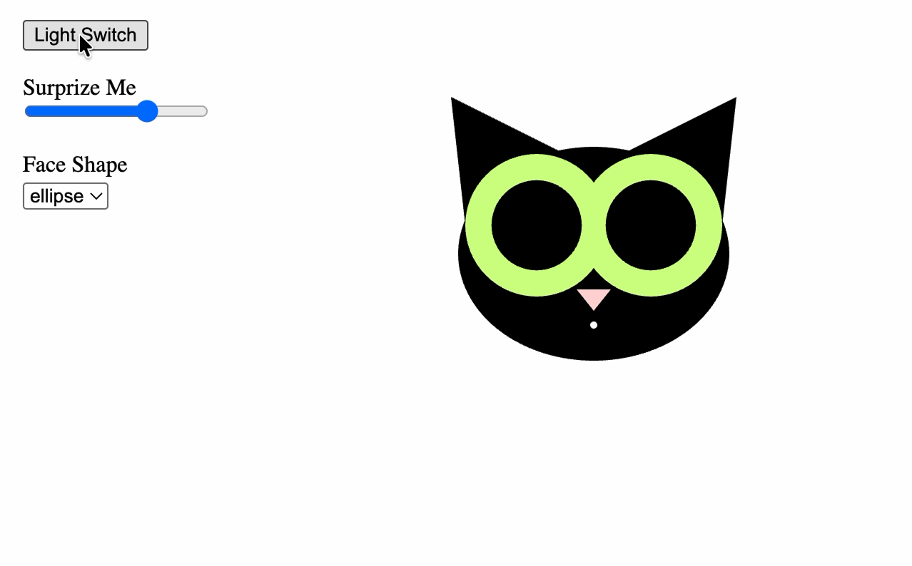

# Week 10 — Interface Design

---

### Activities

| Activity | What I Made                   |
| -------- | ----------------------------- |
| `10`     | Created an interactive cat face using p5.js UI elements, including a button, slider, and dropdown menu to control its appearance. |

---

### This Week

I explored how to create interactive interfaces using p5.js. I learned to use createButton(), createSlider(), and createSelect() to control visual elements. I also experimented with if-else statements and for loops to change the background color, and used a slider to adjust the size of the cat's pupils. Through this activity, I learned how user inputs can change an object's appearance and behavior.

---

### Output

---