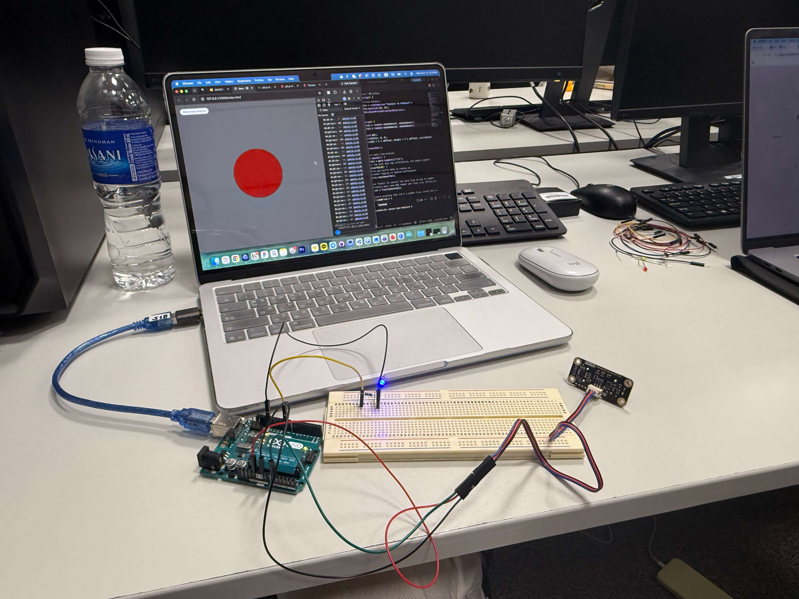

# Sensor Jam — Warning Shaker

---

### The Project

Warning Shaker turns distance sensor readings from an Arduino into a visual warning using p5.js. As an object moves closer to the sensor, the circle grows larger, becomes brighter red, and shakes more intensely. As the object moves away, the circle becomes smaller and darker.

---

### Screenshots

### Demo Video

![Screenshot1] (documentation/sensor-jam-video-changing-color.mp4)
![Screenshot2] (documentation/sensor-jam-video-shaking.mp4)

---

### 🧩 Something I Found Interesting

Generating random position offsets every frame creates the shaking effect.
     // let xOffset = random(-shakeAmount, shakeAmount);
     // let yOffset = random(-shakeAmount, shakeAmount);

### 🔗 References
Shaking Object Code - p5js (https://editor.p5js.org/luisa_NYU/sketches/QEM1tnYXE)
