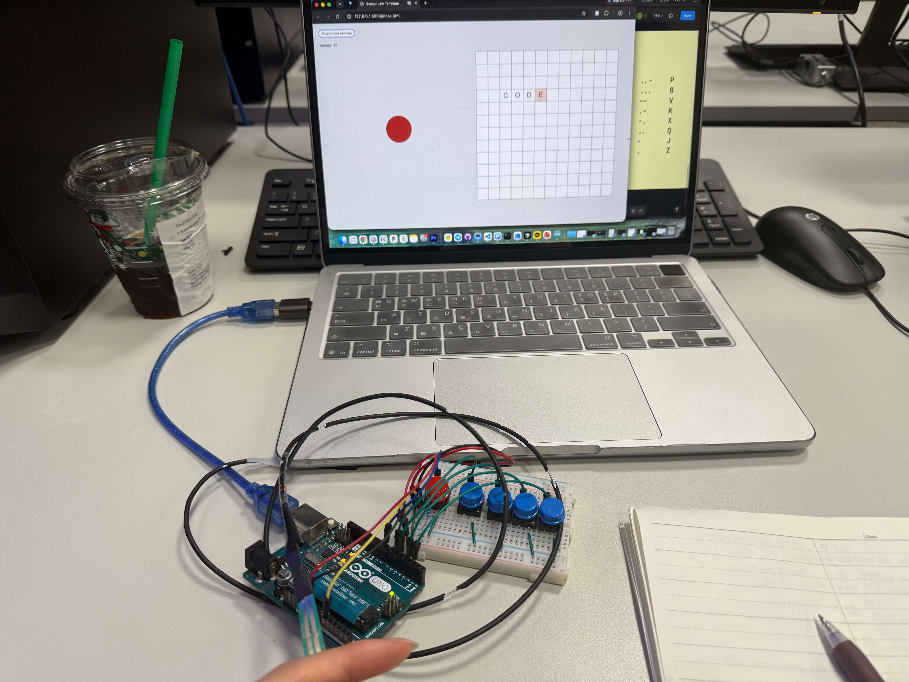
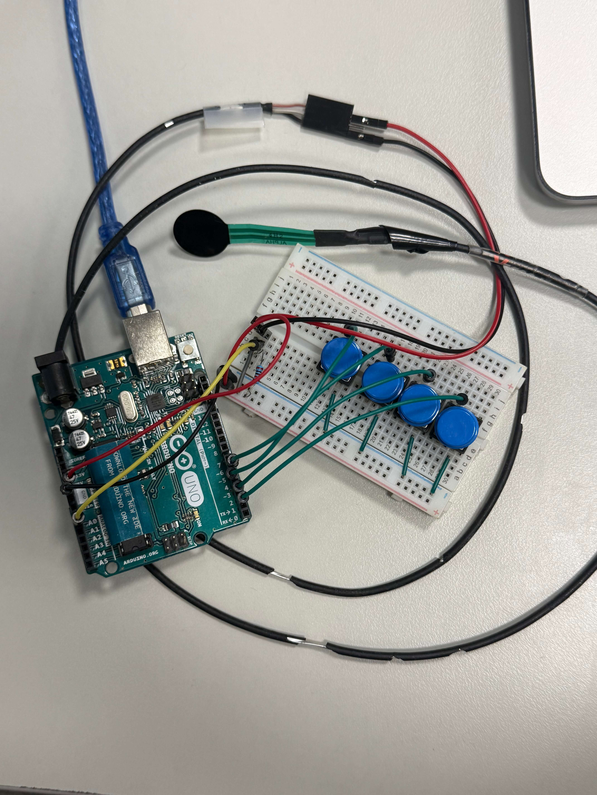

# Final Project — Slow Morse

### Concept
Slow Morse is a physical text input interface that invites users to slow down and compose messages deliberately. Short and long presses on a force sensor create dots and dashes, which become letters through a custom Morse mapping. Four direction buttons let users arrange letters on a grid.

### Features
- Force sensor input: short presses for dots and long presses for dashes
- Custom Morse-to-letter mapping
- Automatic letter decoding after an 800 ms pause
- A 12 × 12 grid with four-button navigation
- Animated circle showing press and release states
- Keyboard controls: arrow keys to move, Backspace/Delete to erase, and R to reset
- Spacebar input for testing when Arduino is disconnected

### Documentation
#### Photo

#### Demo Video

### 🔍 Code Structure
- setup() — Initialises the canvas, serial connection, and grid.
- draw() — Reads sensor and button data and updates the interface.
- setPressed() — Measures press duration to generate dots and dashes.
- decodeMorse() — Converts a completed sequence into a letter.
- drawGrid() — Displays letters and highlights the selected cell.
- keyPressed() / keyReleased() — Handle keyboard controls.
- resetGrid() — Clears the grid, cursor position, and current sequence.
- connectBtnClick() / updateConnectBtn() — Manage the Arduino connection and button state.